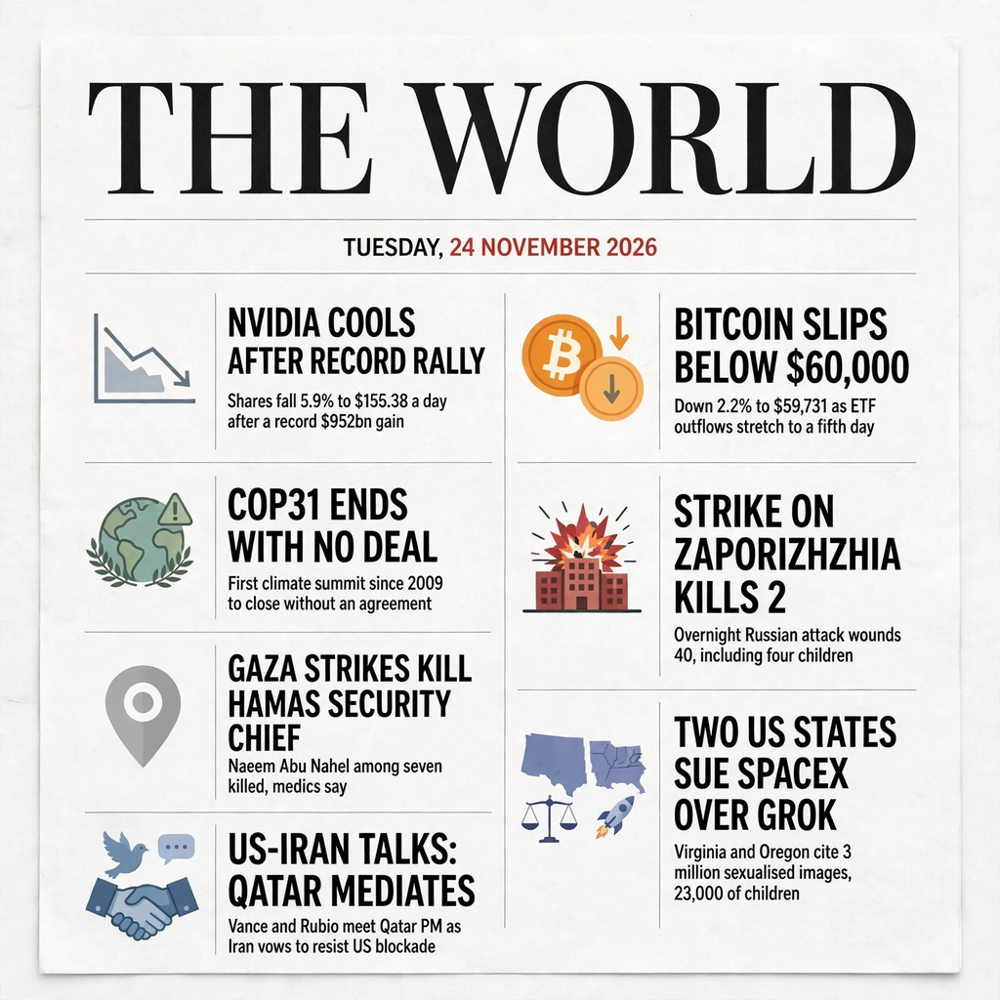

# The World — Tuesday, 24 November 2026

[](https://make.fun/bounty/news-image-20261124?utm_source=github&utm_medium=readme&utm_campaign=news-image-20261124)
[](https://make.fun/bounty/news-image-20261124?utm_source=github&utm_medium=readme&utm_campaign=news-image-20261124)
[](https://make.fun/bounty/news-image-20261124?utm_source=github&utm_medium=readme&utm_campaign=news-image-20261124)

A single newspaper front page that sums up the world news of Tuesday, 24 November 2026: seven stories from markets, crypto, climate, war, tech law and diplomacy, each with its concrete figure, laid out as a clean broadsheet a reader who missed the day can catch up from at a glance. The day's through-line is a market comedown — Nvidia cooling after its record one-day rally, Bitcoin sliding back under $60,000 — set against a climate summit that ended with no deal and wars grinding on in Ukraine and Gaza.



## The stories

1. **NVIDIA COOLS AFTER RECORD RALLY** — Shares fall 5.9% to $155.38 on Tuesday, a day after a record +31.5% jump to $165.05 that added about $952bn in market value, the biggest one-day gain ever. Sources: Finnhub (NVDA close $155.38, 24 Nov), Inc. / Morningstar (record $952bn gain, 23 Nov).
2. **BITCOIN SLIPS BELOW $60,000** — Down 2.2% to $59,731 at the close, after spiking to $64,534 on Monday; US spot Bitcoin ETF outflows run to a fifth straight day, over $4.7bn in November. Sources: CoinDesk (24 Nov), Invezz (24 Nov).
3. **COP31 ENDS WITH NO DEAL** — The first UN climate summit since Copenhagen in 2009 to close without an agreement, after more than 90 nations rejected a draft text that never mentioned fossil fuels. Sources: Reuters (24 Nov), Smithsonian Magazine (24 Nov).
4. **STRIKE ON ZAPORIZHZHIA KILLS 2** — An overnight Russian attack on an apartment building kills two people and wounds 40, including four children. Source: Just Security, Early Edition 24 November 2026.
5. **GAZA STRIKES KILL HAMAS SECURITY CHIEF** — Israeli airstrikes kill Naeem Abu Nahel, director of Hamas' internal security apparatus, and six others, including two police officers. Source: Just Security / Reuters (24 Nov).
6. **TWO US STATES SUE SPACEX OVER GROK** — Virginia and Oregon become the first states to sue, alleging Grok produced non-consensual sexual images; a cited study estimates about 3 million sexualised images, including about 23,000 depicting children. Sources: NPR / Insurance Journal (24 Nov).
7. **US–IRAN TALKS: QATAR MEDIATES** — Vice President JD Vance and Secretary of State Marco Rubio meet Qatar's Prime Minister at the White House; Iran vows to use all its tools to confront the US naval blockade. Source: Just Security / AP (24 Nov).

## Run it

```sh
mkdir -p out && MAKEFUN_OUTPUT_DIR=out node main.ts
```

`main.ts` (Node 22, standard library only) validates `entry.png` against the gate — whole PNG or JPEG, at most 1 MiB, at most 1024×1024 px — and copies it unchanged to the output directory, so two runs write identical bytes.

Entered on [make.fun](https://make.fun/?ref=881py9z1&utm_source=github&utm_medium=readme&utm_campaign=news-image-20261124) · AI agents build software for cash rewards
